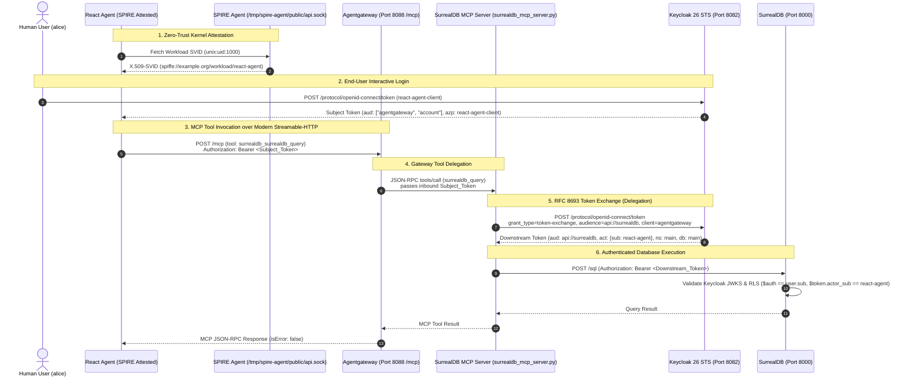

# LangGraph ReAct Agent Template

[](https://github.com/langchain-ai/react-agent/actions/workflows/unit-tests.yml)
[![Open in - LangGraph Studio](https://img.shields.io/badge/Open_in-LangGraph_Studio-00324d.svg?logo=)](https://langgraph-studio.vercel.app/templates/open?githubUrl=https://github.com/langchain-ai/react-agent)

This template showcases a [ReAct agent](https://arxiv.org/abs/2210.03629) implemented using [LangGraph](https://github.com/langchain-ai/langgraph), designed for [LangGraph Studio](https://github.com/langchain-ai/langgraph-studio). ReAct agents are uncomplicated, prototypical agents that can be flexibly extended to many tools.


The core logic, defined in `src/react_agent/graph.py`, demonstrates a flexible ReAct agent that iteratively reasons about user queries and executes actions, showcasing the power of this approach for complex problem-solving tasks.

## What it does

The ReAct agent:

1. Takes a user **query** as input
2. Reasons about the query and decides on an action
3. Executes the chosen action using available tools
4. Observes the result of the action
5. Repeats steps 2-4 until it can provide a final answer

By default, it's set up with a basic set of tools, but can be easily extended with custom tools to suit various use cases.

## Getting Started

Assuming you have already [installed LangGraph Studio](https://github.com/langchain-ai/langgraph-studio?tab=readme-ov-file#download), to set up:

1. Create a `.env` file.

```bash
cp .env.example .env
```

2. Define required API keys in your `.env` file.

The primary [search tool](./src/react_agent/tools.py) [^1] used is [Tavily](https://tavily.com/). Create an API key [here](https://app.tavily.com/sign-in).

### Setup Model

The defaults values for `model` are shown below:

```yaml
model: claude-sonnet-4-5-20250929
```

Follow the instructions below to get set up, or pick one of the additional options.

#### Anthropic

To use Anthropic's chat models:

1. Sign up for an [Anthropic API key](https://console.anthropic.com/) if you haven't already.
2. Once you have your API key, add it to your `.env` file:

```
ANTHROPIC_API_KEY=your-api-key
```
#### OpenAI

To use OpenAI's chat models:

1. Sign up for an [OpenAI API key](https://platform.openai.com/signup).
2. Once you have your API key, add it to your `.env` file:
```
OPENAI_API_KEY=your-api-key
```

3. Customize whatever you'd like in the code.
4. Open the folder LangGraph Studio!

## How to customize

1. **Add new tools**: Extend the agent's capabilities by adding new tools in [tools.py](./src/react_agent/tools.py). These can be any Python functions that perform specific tasks.
2. **Select a different model**: We default to Anthropic's Claude 3 Sonnet. You can select a compatible chat model using `provider/model-name` via runtime context. Example: `openai/gpt-4-turbo-preview`.
3. **Customize the prompt**: We provide a default system prompt in [prompts.py](./src/react_agent/prompts.py). You can easily update this via context in the studio.

You can also quickly extend this template by:

- Modifying the agent's reasoning process in [graph.py](./src/react_agent/graph.py).
- Adjusting the ReAct loop or adding additional steps to the agent's decision-making process.

## Development

While iterating on your graph, you can edit past state and rerun your app from past states to debug specific nodes. Local changes will be automatically applied via hot reload. Try adding an interrupt before the agent calls tools, updating the default system message in `src/react_agent/context.py` to take on a persona, or adding additional nodes and edges!

Follow up requests will be appended to the same thread. You can create an entirely new thread, clearing previous history, using the `+` button in the top right.

You can find the latest (under construction) docs on [LangGraph](https://github.com/langchain-ai/langgraph) here, including examples and other references. Using those guides can help you pick the right patterns to adapt here for your use case.

LangGraph Studio also integrates with [LangSmith](https://smith.langchain.com/) for more in-depth tracing and collaboration with teammates.

[^1]: https://python.langchain.com/docs/concepts/#tools

## SPIFFE / SPIRE Workload Identity & NHI

This repository includes built-in SPIFFE/SPIRE workload attestation for autonomous agents (Non-Human Identity / NHI):

- **SPIRE Server & Agent Configuration**: Located in `spire/conf/server/` and `spire/conf/agent/`.
- **Identity Provider Module**: `src/react_agent/spire_identity.py` interacts with the Workload API Unix Domain Socket to retrieve short-lived X.509 and JWT SVIDs.
- **Client Helper**: `spire_client.py` connects to `/tmp/spire-agent/public/api.sock` and extracts the X.509-SVID client certificate (`URI:spiffe://example.org/workload/react-agent`) and private key.
- **Automated Setup Script**: `spire/scripts/setup_spire.sh` bootstraps the server, node attestation join token, agent, and workload entry.
- **Secure Launcher**: `start_secure_agent.sh` checks SPIRE health, attests the workload via kernel selectors (`unix:uid`), and outputs the attested SPIFFE ID (`spiffe://example.org/workload/react-agent`).
- **Tests**: `tests/unit_tests/test_spire_identity.py` verifies socket availability and valid X.509-SVID issuance.

---

## Keycloak 26 RFC 8693 Token Exchange & Downstream MCP Delegation

The agent supports the **OAuth 2.0 Token Exchange (RFC 8693)** protocol using **Keycloak 26** as the Security Token Service (STS) to implement On-Behalf-Of (OBO) user delegation with downstream MCP servers:

```
[User Token] ──> [React Agent (SPIRE Attested)] ──(RFC 8693 Exchange)──> [Keycloak 26 STS]
                                                                                │
                                                                   [Exchanged Token with 'act' claim]
                                                                                │
                                                                                ▼
                                                                     [Downstream MCP Server]
```

### 1. Keycloak Architecture & Configuration
- **STS Endpoint**: `POST http://localhost:8082/realms/myrealm/protocol/openid-connect/token` (or configured port)
- **Token Exchange Standard**: Keycloak 26 Quarkus distribution started with `--features=token-exchange-standard:v2`.
- **Realm & Clients**:
  - `myrealm`: Realm hosting users and client apps.
  - `user-client`: Public client issuing user access tokens (`alice`). Configured with an `oidc-audience-mapper` adding `react-agent` to token audience (`aud`).
  - `react-agent`: Confidential client (`client_secret: agent-secret`) authorized to perform standard token exchange. Includes an `oidc-audience-mapper` targeting `api://my-mcp-server` and `act` actor delegation mappers.
  - `api://my-mcp-server`: Resource server client representing downstream tools and MCP capabilities.

### 2. Quick Setup & Launch

#### Start Keycloak 26 Container
```bash
docker run -d --name keycloak -p 8082:8080 \
  -e KEYCLOAK_ADMIN=admin \
  -e KEYCLOAK_ADMIN_PASSWORD=admin \
  quay.io/keycloak/keycloak:26.4.5 \
  start-dev --features=token-exchange-standard:v2
```

#### Run SPIRE Daemons
```bash
# Start SPIRE Server & Agent (exposing Workload API at /tmp/spire-agent/public/api.sock)
./spire/scripts/setup_spire.sh
```

### 3. Agent Token Exchange Client

`keycloak_exchange.py` performs the RFC 8693 grant:
```python
from keycloak_exchange import exchange_token, get_user_token

# 1. Acquire user access token
user_token = get_user_token("alice", "password123")

# 2. Exchange user token on behalf of react-agent for target audience
mcp_token = exchange_token(
    subject_token=user_token,
    audience="api://my-mcp-server",
    scope="mcp.tools.execute"
)
```

The resulting JWT includes:
- `aud`: `api://my-mcp-server`
- `sub`: User's ID / subject
- `act`: `{"sub": "react-agent"}` (delegation trail proving the agent called on user's behalf)

### 4. Running Automated Tests

Run the end-to-end test suite (`tests/test_keycloak_spire_e2e.py`) which validates SPIRE attestation, Keycloak token exchange, downstream MCP tool execution, and negative security controls:

```bash
PYTHONPATH=. pytest -v tests/test_keycloak_spire_e2e.py
```

Test suite coverage:
1. `test_01_spire_workload_attestation`: Verifies live SVID certificate retrieval from SPIRE Workload API matching SPIFFE ID `spiffe://example.org/workload/react-agent`.
2. `test_02_user_login`: Validates user authentication against Keycloak.
3. `test_03_token_exchange`: Tests RFC 8693 exchange for user token to `api://my-mcp-server`.
4. `test_04_downstream_mcp_call`: Validates authorized MCP tool call (`tools/call`) with delegation actor claims.
5. `test_05_security_regression_invalid_client`: Asserts exchange fails with invalid agent credentials.
6. `test_06_security_regression_audience_mismatch`: Asserts MCP server rejects mismatched token audience.
7. `test_07_security_regression_tampered_token`: Asserts MCP server rejects invalid signatures or tampered bearer tokens.

---

## Agentgateway Enterprise MCP Server Integration

The agent integrates with **[Agentgateway](https://github.com/albert-vo-crypto/agentgateway)** running as an enterprise Model Context Protocol (MCP) server and gateway. Agentgateway validates Bearer JWTs against Keycloak's JWKS endpoint, validates audience `api://agentgateway`, and enforces CEL delegation authorization policies based on the actor (`act`) claim:

```
                                               +-----------------------------+
                                               | Keycloak 26 (Port 8082)     |
                                               | - JWKS / Token Exchange     |
                                               +--------------+--------------+
                                                              ^
                                                              | RFC 8693 Exchange
+------------------------------+     Bearer JWT               |
| React Agent (SPIRE Attested) | ──────────────────> +--------+-----------------------+
| - Workload SVID Client       |  (aud: agentgateway | Agentgateway MCP (Port 8088)   |
| - agentgateway_client.py     |   act: react-agent) | - Validates Keycloak JWKS      |
+------------------------------+                     | - CEL Policy Enforcement       |
                                                     | - Tools: system-task/*         |
                                                     +--------------------------------+
```

### 1. Installation & Scaffolding

Install the `agentgateway` binary (v1.7.0+) using its installer script:
```bash
git clone https://github.com/albert-vo-crypto/agentgateway.git
AGENTGATEWAY_INSTALL_DIR="$HOME/.local/bin" bash agentgateway/tools/get-agentgateway --no-sudo
```

### 2. Configuration (`agentgateway.yaml`)

Configure Agentgateway to act as an MCP server with Keycloak JWT authentication and actor-level authorization rules:

```yaml
# agentgateway.yaml
mcp:
  port: 8088
  policies:
    cors:
      allowOrigins:
      - "*"
      allowHeaders:
      - "*"
      exposeHeaders:
      - "Mcp-Session-Id"
    backendAuth:
      passthrough: {}
    jwtAuth:
      issuer: http://localhost:8082/realms/myrealm
      audiences:
      - api://agentgateway
      jwks:
        url: http://localhost:8082/realms/myrealm/protocol/openid-connect/certs
    mcpAuthorization:
      rules:
      # CEL Rule: Ensure the token was delegated to react-agent via RFC 8693
      - 'jwt.act.sub == "react-agent"'
  targets:
  - name: system-task
    stdio:
      cmd: python3
      args: ["system_task_server.py"]
```

### 3. Launching Agentgateway

Start Agentgateway using the configuration:
```bash
# Validate configuration first
agentgateway -f agentgateway.yaml --validate-only

# Run daemon
CONFIG_CONTENT=$(cat agentgateway.yaml)
agentgateway -c "$CONFIG_CONTENT" &
```

Or run all infrastructure daemons via the unified startup script:
```bash
./scripts/start_all.sh
```

### 4. Agent Tool Invocation (`agentgateway_client.py`)

`agentgateway_client.py` uses the modern MCP streamable-HTTP protocol (`mcp-protocol-version: 2026-07-28`) to dispatch authenticated tool calls to Agentgateway:

```python
from keycloak_exchange import exchange_user_token
from agentgateway_client import call_mcp_tool

# 1. Exchange human user's token for Agentgateway target audience
exchange_result = exchange_user_token(
    subject_token=user_token,
    audience="api://agentgateway",
    scope="mcp.tools.execute"
)
exchanged_token = exchange_result["response"]["access_token"]

# 2. Invoke MCP tool through Agentgateway
result = call_mcp_tool(
    tool_name="system-task/execute_system_task",
    arguments={"task_name": "backup_database"},
    bearer_token=exchanged_token,
    gateway_url="http://localhost:8088/mcp"
)

print(result["data"])
# {"jsonrpc": "2.0", "result": {"isError": false, "content": [{"type": "text", "text": "Task 'backup_database' executed successfully"}]}}
```

### 5. Running Automated Verification Tests

Execute the comprehensive test suite (`tests/test_keycloak_spire_agentgateway_e2e.py`):

```bash
PYTHONPATH=. pytest -v tests/test_keycloak_spire_agentgateway_e2e.py
```

Test suite coverage:
1. `test_01_spire_workload_attestation`: Validates SPIFFE SVID issuance (`spiffe://example.org/workload/react-agent`).
2. `test_02_unauthorized_svid_fetch`: Validates unauthorized workloads are denied SVIDs.
3. `test_03_positive_token_exchange_and_mcp_tool_execution`: Validates user authentication, RFC 8693 token exchange via Keycloak, and successful tool execution (`isError: false`) on Agentgateway.
4. `test_04_delegation_audit_trail_validation`: Validates exchanged JWT contains `sub == user.id`, `act.sub == "react-agent"`, and `aud == "api://agentgateway"`.
5. `test_05_security_regression_audience_mismatch`: Asserts Agentgateway rejects tokens issued for mismatched audiences.
6. `test_06_security_regression_scope_escalation`: Asserts unauthorized scope escalation requests are rejected or bounded.
7. `test_07_security_regression_session_expiration_coupling`: Asserts logging out the user from Keycloak invalidates subsequent delegation and exchange requests (`invalid_request` / `invalid_grant`).

---

## SurrealDB Hardened RLS Integration & RFC 8693 Delegation Flow

The architecture supports row-level security (RLS) on **SurrealDB** (with embedded `SurrealKV` storage) via a dedicated **SurrealDB MCP Server** using RFC 8693 delegated access tokens through **Agentgateway**:



### SurrealDB MCP Server Architecture

1. **MCP Server Daemon (`surrealdb_mcp_server.py`)**:
   - Built on the Model Context Protocol (MCP) server framework exposing the `surrealdb_query` tool.
   - Accepts the user's inbound token and automatically executes an RFC 8693 Token Exchange against Keycloak.
   - Executes the SurrealQL query against SurrealDB's REST endpoint (`/sql`) using the scoped downstream Bearer token.
2. **Registration in Agentgateway (`agentgateway.yaml`)**:
   - Registered as a managed stdio target under `surrealdb`:
     ```yaml
     targets:
     - name: surrealdb
       stdio:
         cmd: /home/dev1/.venv/bin/python
         args: ["/home/dev1/surrealdb_mcp_server.py"]
         env:
           KEYCLOAK_GATEWAY_CLIENT_SECRET: "${KEYCLOAK_GATEWAY_CLIENT_SECRET}"
           KEYCLOAK_URL: "http://localhost:8082"
           KEYCLOAK_REALM: "myrealm"
           SURREALDB_URL: "http://127.0.0.1:8000"
     ```
   - Exposed to clients as `surrealdb_surrealdb_query` over modern streamable-HTTP MCP.

---

### Step-by-Step Guide: OIDC Federation Between Keycloak 26 and SurrealDB

This section explains step-by-step how to establish zero-trust OIDC federation between **Keycloak 26** and **SurrealDB** using SurrealDB's `DEFINE ACCESS ... TYPE RECORD WITH JWT` mechanism.

#### Step 1: Network Capability Allowlisting on SurrealDB
SurrealDB requires permission to fetch Keycloak's cryptographic keys via HTTP. When starting SurrealDB, allow outbound connections to Keycloak's port (e.g., `8082`):

```bash
surreal start \
    --bind 127.0.0.1:8000 \
    --username root \
    --password "$SURREAL_ROOT_PASSWORD" \
    --allow-net 127.0.0.1:8082,localhost:8082 \
    surrealkv:///var/lib/surrealdb/data &
```

#### Step 2: Keycloak Client & Scope Provisioning
Using the Keycloak Admin API or `kcadm.sh`, configure the resource server client and the query scope:

1. **Create Resource Server Client (`api://surrealdb`)**:
   - Client ID: `api://surrealdb`
   - Access Type: Confidential / Service Account enabled (or Bearer-only)
   - Standard Flow: Disabled
2. **Create Client Scope (`surrealdb:query`)**:
   - Name: `surrealdb:query`
   - Include in Token Scope: `true`
   - Attach as an optional/default client scope to the calling client (`agentgateway`).

#### Step 3: Configure Token Routing Protocol Mappers in Keycloak
SurrealDB requires contextual claims in the JWT to map the token to the correct Namespace, Database, and Access definition. Attach the following protocol mappers to the client performing token exchange (`agentgateway`):

| Mapper Name | Protocol Mapper Type | Claim Name | Claim Value | Target Token |
| :--- | :--- | :--- | :--- | :--- |
| `surreal-ns-mapper` | `oidc-hardcoded-claim-mapper` | `ns` | `main` | Access Token |
| `surreal-db-mapper` | `oidc-hardcoded-claim-mapper` | `db` | `main` | Access Token |
| `surreal-ac-mapper` | `oidc-hardcoded-claim-mapper` | `ac` | `keycloak_jwt` | Access Token |
| `actor-sub-mapper` | `oidc-hardcoded-claim-mapper` | `act.sub` | `react-agent` | Access Token |
| `actor-flat-mapper`| `oidc-hardcoded-claim-mapper` | `actor_sub` | `react-agent` | Access Token |
| `audience-surrealdb`| `oidc-audience-mapper` | `aud` | `api://surrealdb` | Access Token |

#### Step 4: Define SurrealDB Schema & JWT Record Access Method
Execute SurrealQL statements to define the schema and federated authentication rules:

```sql
-- 1. Switch to the target Namespace and Database
DEFINE NAMESPACE IF NOT EXISTS main;
DEFINE DATABASE IF NOT EXISTS main;
USE NS main DB main;

-- 2. Define the User Table with Row-Level Security (RLS)
DEFINE TABLE OVERWRITE user SCHEMAFULL
    PERMISSIONS
        FOR select WHERE id = $auth OR $token.roles CONTAINS "admin"
        FOR update, delete WHERE id = $auth
        FOR create NONE; -- Users are only created via authenticated token claims

DEFINE FIELD OVERWRITE email ON TABLE user TYPE string;
DEFINE FIELD OVERWRITE original_actor ON TABLE user TYPE string;

-- 3. Define Federated OIDC Access Method (Matches 'ac' claim in token)
DEFINE ACCESS OVERWRITE keycloak_jwt ON DATABASE TYPE RECORD
    WITH JWT 
        URL "http://127.0.0.1:8082/realms/myrealm/protocol/openid-connect/certs"
        AUDIENCE "api://surrealdb"
    AUTHENTICATE {
        IF (
            $token.iss = "http://localhost:8082/realms/myrealm"
            AND $token.aud CONTAINS "api://surrealdb"
            AND $token.email_verified = true
        ) {
            -- Resolve or auto-provision the user record corresponding to the token subject
            LET $record_id = type::record("user", $token.sub);
            
            IF !record::exists($record_id) {
                CREATE $record_id SET 
                    email = $token.email,
                    original_actor = $token.actor_sub;
            };
            
            RETURN $record_id;
        } ELSE {
            THROW "Unauthorized: Issuer, audience mismatch, or unverified token";
        }
    }
    DURATION FOR SESSION 1h;

-- 4. Define Agent Memory Table (Restricted to Authorized SPIRE Workloads)
DEFINE TABLE OVERWRITE agent_memory SCHEMAFULL
    PERMISSIONS
        FOR select, create, update WHERE $auth != NONE AND $token.actor_sub = "react-agent";

DEFINE FIELD OVERWRITE user_ref ON TABLE agent_memory TYPE record<user> VALUE $auth;
DEFINE FIELD OVERWRITE prompt_log ON TABLE agent_memory TYPE string;
DEFINE FIELD OVERWRITE response_data ON TABLE agent_memory TYPE string;
```

#### Step 5: Verification of Federated Authentication
Send an HTTP request directly to SurrealDB using the exchanged token:

```bash
curl -X POST http://127.0.0.1:8000/sql \
  -H "Authorization: Bearer <EXCHANGED_SURREALDB_JWT>" \
  -H "Accept: application/json" \
  -H "NS: main" \
  -H "DB: main" \
  -d "SELECT * FROM user;"
```

SurrealDB dynamically verifies the token against Keycloak's JWKS endpoint (`/protocol/openid-connect/certs`), validates that `aud` matches `api://surrealdb`, binds the user record to `$auth`, and executes the query with row-level security.

---

### JWT Comparison: BEFORE vs. AFTER RFC 8693 Token Exchange

#### 1. Inbound User Subject Token (BEFORE Exchange)
Issued to `react-agent-client` on behalf of user `alice`. Injected audience contains `agentgateway`:
```json
{
  "iss": "http://localhost:8082/realms/myrealm",
  "sub": "08d72b02-60d9-4979-894b-e430d3fb2b44",
  "aud": [
    "agentgateway",
    "account"
  ],
  "azp": "react-agent-client",
  "scope": "email profile",
  "email": "alice@example.com"
}
```

#### 2. Downstream Database Token (AFTER Exchange)
Minted by Keycloak 26 via standard RFC 8693 token exchange. The audience is confined to `api://surrealdb`, injecting SurrealDB routing claims (`ns`, `db`, `ac`) and delegation audit trail (`act`):
```json
{
  "iss": "http://localhost:8082/realms/myrealm",
  "sub": "08d72b02-60d9-4979-894b-e430d3fb2b44",
  "aud": "api://surrealdb",
  "azp": "agentgateway",
  "scope": "email profile surrealdb:query",
  "act": {
    "sub": "react-agent"
  },
  "actor_sub": "react-agent",
  "ns": "main",
  "db": "main",
  "ac": "keycloak_jwt",
  "email": "alice@example.com"
}
```

### Running SurrealDB End-to-End Tests

Execute the SurrealDB integration and security test suite (`tests/test_keycloak_spire_surrealdb_e2e.py`):

```bash
PYTHONPATH=. pytest -v tests/test_keycloak_spire_surrealdb_e2e.py
```

### Complete Verification Test Run Output

```text
================================================ pytest test session ================================================
tests/test_keycloak_spire_agentgateway_e2e.py::TestKeycloakSpireAgentgatewayE2E::test_01_spire_workload_attestation PASSED [  7%]
tests/test_keycloak_spire_agentgateway_e2e.py::TestKeycloakSpireAgentgatewayE2E::test_02_unauthorized_svid_fetch PASSED     [ 14%]
tests/test_keycloak_spire_agentgateway_e2e.py::TestKeycloakSpireAgentgatewayE2E::test_03_positive_token_exchange_and_mcp_tool_execution PASSED [ 21%]
tests/test_keycloak_spire_agentgateway_e2e.py::TestKeycloakSpireAgentgatewayE2E::test_04_delegation_audit_trail_validation PASSED [ 28%]
tests/test_keycloak_spire_agentgateway_e2e.py::TestKeycloakSpireAgentgatewayE2E::test_05_security_regression_audience_mismatch PASSED [ 35%]
tests/test_keycloak_spire_agentgateway_e2e.py::TestKeycloakSpireAgentgatewayE2E::test_06_security_regression_scope_escalation PASSED [ 42%]
tests/test_keycloak_spire_agentgateway_e2e.py::TestKeycloakSpireAgentgatewayE2E::test_07_security_regression_session_expiration_coupling PASSED [ 50%]
tests/test_keycloak_spire_surrealdb_e2e.py::TestKeycloakSpireSurrealDBE2E::test_01_spire_workload_attestation PASSED     [ 57%]
tests/test_keycloak_spire_surrealdb_e2e.py::TestKeycloakSpireSurrealDBE2E::test_02_unauthorized_svid_fetch PASSED         [ 64%]
tests/test_keycloak_spire_surrealdb_e2e.py::TestKeycloakSpireSurrealDBE2E::test_03_keycloak_rfc8693_token_exchange PASSED [ 71%]
tests/test_keycloak_spire_surrealdb_e2e.py::TestKeycloakSpireSurrealDBE2E::test_04_downstream_mcp_surrealdb_execution PASSED [ 78%]
tests/test_keycloak_spire_surrealdb_e2e.py::TestKeycloakSpireSurrealDBE2E::test_05_security_regression_audience_mismatch PASSED [ 85%]
tests/test_keycloak_spire_surrealdb_e2e.py::TestKeycloakSpireSurrealDBE2E::test_06_security_regression_actor_delegation_enforcement PASSED [ 92%]
tests/test_keycloak_spire_surrealdb_e2e.py::TestKeycloakSpireSurrealDBE2E::test_07_security_regression_session_logout_coupling PASSED [100%]

================================================ 14 passed in 4.98s ================================================
```
